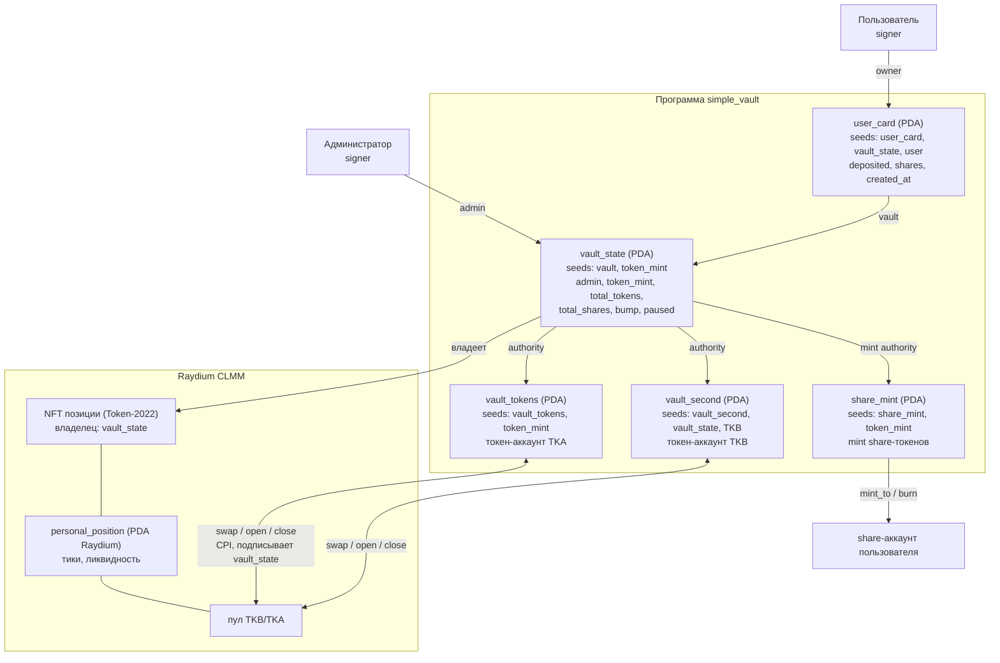

# Liquidity Vault — неделя 14 (Capstone)

Liquidity Vault — это хранилище токенов на Solana (devnet) с веб-интерфейсом. Пользователь вносит токен TKA и получает share-токены — свою долю в vault. Администратор размещает средства vault в CLMM-пуле Raydium: открывает позицию, собирает комиссии с обменов, закрывает позицию и меняет токены. Комиссии увеличивают объём средств vault, а значит, и стоимость каждого share.

Всё делается через браузер и кошелёк Phantom или Solflare, терминал не нужен.

## Возможности

**Пользователь** (любой кошелёк):
- подключение Phantom или Solflare (devnet);
- баланс SOL, TKA и share-токенов, стоимость своих shares;
- сколько всего в vault: внесено, shares, цена одного share, балансы хранилищ TKA и TKB;
- «Создать карточку» (один раз), «Внести», «Вывести», «Закрыть карточку»; перед отправкой видно, сколько shares или TKA получишь;
- статус транзакции (ожидание → успех или ошибка с логами программы) и ссылка на Explorer;
- история транзакций за сессию.

**Администратор** (только кошелёк `vault_state.admin`):
- цена пула Raydium CLMM;
- позиции vault: приложение само находит NFT позиций у PDA vault и показывает диапазон, статус «в диапазоне / вне диапазона» и сколько вернётся при закрытии;
- «Собрать комиссии», «Закрыть позицию» (минимумы −1%);
- «Открыть позицию»: диапазон «текущая цена ± %», сумма TKB, расчёт TKA и лимитов перед отправкой;
- «Обмен» TKA ↔ TKB с расчётом результата и защитой от slippage 1%.

## Адреса (devnet)

| Что | Адрес |
|---|---|
| Программа `simple_vault` | [`25exdZUmhe6Xah5wxHrXf1w851F3Da36tb4W2E6fG6L4`](https://explorer.solana.com/address/25exdZUmhe6Xah5wxHrXf1w851F3Da36tb4W2E6fG6L4?cluster=devnet) |
| `vault_state` (PDA) | [`AhcvxRaZ7Pbs3zZNug3FCD6wdgvD5djteBvpj5RqW43q`](https://explorer.solana.com/address/AhcvxRaZ7Pbs3zZNug3FCD6wdgvD5djteBvpj5RqW43q?cluster=devnet) |
| Хранилище TKA `vault_tokens` | [`4jfw68Db59tUdea3Vc1nTdPwMPupRFuBPz5ozq9swBGR`](https://explorer.solana.com/address/4jfw68Db59tUdea3Vc1nTdPwMPupRFuBPz5ozq9swBGR?cluster=devnet) |
| Хранилище TKB `vault_second` | [`6xSU2MscpcFgCoXCkPFCkv4cetumbwogmc26eAfTexp9`](https://explorer.solana.com/address/6xSU2MscpcFgCoXCkPFCkv4cetumbwogmc26eAfTexp9?cluster=devnet) |
| Администратор | `2X4SLNfrSiUYo8fUjemdsvH2KJdwbtWQrTvmHt2EpLyH` |
| Токен TKA (токен vault) | `58yZV9EGzxW1b7xBhMKC7VAMq5599VCdhMQ351eqmGyR` |
| Токен TKB (второй токен пула) | `trXbiGdDwxDCpKotLVBns8ueu1aagEwjb17YFT3XN3e` |
| CLMM-пул Raydium TKB/TKA (0,25%) | [`5Bpew1UyKwP9YcZNxS4XhouCc5inW4ooF7MeCRYSZwZp`](https://explorer.solana.com/address/5Bpew1UyKwP9YcZNxS4XhouCc5inW4ooF7MeCRYSZwZp?cluster=devnet) |
| Raydium CLMM (devnet) | `DRayAUgENGQBKVaX8owNhgzkEDyoHTGVEGHVJT1E9pfH` |

## Схема аккаунтов



| Аккаунт | Seeds | Что хранит |
|---|---|---|
| `vault_state` | `["vault", token_mint]` | admin, token_mint, vault_token_account, share_mint, total_tokens, total_shares, bump, paused |
| `vault_tokens` | `["vault_tokens", token_mint]` | токены TKA vault; authority — `vault_state` |
| `share_mint` | `["share_mint", token_mint]` | mint share-токенов; mint authority — `vault_state` |
| `vault_second` | `["vault_second", vault_state, second_mint]` | токены TKB vault; authority — `vault_state` |
| `user_card` | `["user_card", vault_state, user]` | vault, owner, created_at, deposited, shares, bump |

## Инструкции программы

| Инструкция | Кто | Что делает |
|---|---|---|
| `initialize_vault` | админ | создаёт `vault_state`, хранилище TKA и `share_mint` |
| `create_user_card` / `close_user_card` | пользователь | личная карточка; закрыть можно только без shares (`CardHasShares`) |
| `deposit(amount)` | пользователь | TKA → vault, выпуск shares: `amount × total_shares / total_tokens` (первый депозит 1:1) |
| `withdraw(shares)` | пользователь | сжигание shares, TKA обратно: `shares × total_tokens / total_shares` |
| `set_paused` | админ | пауза vault |
| `init_second_storage` | админ | хранилище для второго токена пула (TKB) |
| `swap(amount_in, minimum_amount_out, sqrt_price_limit)` | админ | обмен через Raydium CLMM `swap_v2`, обязательный минимум |
| `open_raydium_position(...)` | админ | позиция в CLMM-пуле, NFT получает `vault_state`, лимиты `amount_0_max` / `amount_1_max` |
| `collect_fees` | админ | сбор комиссий позиции (`decrease_liquidity_v2` с ликвидностью 0) |
| `close_raydium_position(min0, min1)` | админ | вывод всей ликвидности с минимумами и сжигание NFT |

## Как запустить

Нужно: Node.js 20+, браузер с Phantom или Solflare.

```bash
git clone https://github.com/mmaissu/vault-dev.git
cd vault-dev
git switch week-14
cd app
npm install
npm run dev
```

Открыть http://localhost:5173.

1. В кошельке включить devnet (Phantom: Настройки → Developer Settings → Testnet Mode → Solana Devnet).
2. Получить devnet SOL: https://faucet.solana.com.
3. TKA — тестовый токен проекта; для проверки его присылает администратор (`spl-token transfer 58yZV9EGzxW1b7xBhMKC7VAMq5599VCdhMQ351eqmGyR <сумма> <адрес> --fund-recipient -u devnet`).
4. Вкладка «Пользователь»: «Создать карточку» → «Внести» → «Вывести».
5. Вкладка «Администратор» доступна только кошельку администратора.

Сборка и деплой программы (WSL, Anchor 0.31.1): `anchor build`, затем `anchor deploy --provider.cluster devnet`. IDL для фронтенда — `target/idl/simple_vault.json`, он скопирован в `app/src/idl.ts`.

## Проверка через интерфейс (devnet)

**Пользователь** (Phantom `9tzhMUHUA92F9cieLFx8VHND2VKe7z3XVwRTtyZ8FgJa`):

| Действие | Транзакция |
|---|---|
| Создать карточку | [49LKjoQV…](https://explorer.solana.com/tx/49LKjoQVZwg3LgNuDRufuPYNdqJamC3JEkNs7HXXbdZZabo4ZPaGUqsqMbMH15QadPWk9PUqZ8a9yXFTgyz8PUdH?cluster=devnet) |
| Внести 20 TKA → 20 shares | [4qDhL2s8…](https://explorer.solana.com/tx/4qDhL2s83YiwNwKbfFQ9U2KNwJ6MUg9GiK9B1agiXs8kU2ubXyop28stppMPKMccBzxtuwggKg7VpLdZnrkkkmuC?cluster=devnet) |
| Вывести 5 shares → 5 TKA | [3FoNaCHM…](https://explorer.solana.com/tx/3FoNaCHM4qkDhzMnsD7Nir7psEFfNqfMCv9AFyD7U3CzxDVNLVxphWkdRhQxfqr4xSjnvV5dDpd4oA3xCXycvLkX?cluster=devnet) |
| Закрыть карточку (проверка) | [2moUdVkp…](https://explorer.solana.com/tx/2moUdVkpHe7ZbQJm4rJcWk4wCuMfR8wPyaxewWaX5STn45dGA7KvgcRmRPNzaxLDg5CL3zHbPR8gVbCmDcS7D2Q8?cluster=devnet) |

**Администратор** (`2X4SLNfrSiUYo8fUjemdsvH2KJdwbtWQrTvmHt2EpLyH`):

| Действие | Транзакция |
|---|---|
| Собрать комиссии | [47Ku9hU7…](https://explorer.solana.com/tx/47Ku9hU7SW2v3A6UTA1GeF76Hgmjj11c7y53QWuGzf9LeUndAZKPeLRkrr9wB1iJEjhHD23qTZEnCzfDr3eS9YyG?cluster=devnet) |
| Обмен 1 TKA → 108,79 TKB | [65gEBWDW…](https://explorer.solana.com/tx/65gEBWDWhcBXGMJk1PbS2jDkyL2KAKVvjSuqdSZPU6WKKeUUVe8e2RCfB8477bprYAH2jLPGK89h6YoKNgRmfdXv?cluster=devnet) |
| Закрыть позицию | [63WEVbbw…](https://explorer.solana.com/tx/63WEVbbwGHSkyojD6SjHrtBQ7ReroQYdXBWZCKKxNRJyNy65ANXhZ9mFTZDCtUPRsz4qLG4Xj7QARvdap9QsDUwT?cluster=devnet) |
| Открыть позицию (97,88 – 120,03 TKB за 1 TKA) | [2dzGUbys…](https://explorer.solana.com/tx/2dzGUbysHUUM8xobk9ZVtEdS1YjeeYkYUPncGGYEhSCyo4cQ2eQSvBtY841KBmQqtqTN1ZgXNZ6oN8qBMzJX2mJQ?cluster=devnet) |

## Структура репозитория

```
programs/simple_vault/src/      программа (Anchor 0.31.1)
  lib.rs                        vault, карточки, депозит, вывод, пауза
  instructions/swap.rs          второе хранилище, обмен через Raydium
  instructions/open_position.rs открытие позиции
  instructions/close_position.rs сбор комиссий, закрытие позиции
tests/                          тесты программы
scripts/week13/                 скрипты недели 13 (позиция, обмены трейдера, ребалансировка)
app/                            веб-интерфейс (React + Vite)
  src/App.tsx                   страница пользователя, статус и история транзакций
  src/Admin.tsx                 страница администратора
  src/raydium.ts                расчёты Raydium CLMM
  src/vault.ts                  адреса и PDA
```

Стек: Anchor 0.31.1, Rust; React 19, Vite, TypeScript; `@solana/web3.js` 1.x, Wallet Adapter, `@coral-xyz/anchor`, `@solana/spl-token`, Raydium SDK v2.

## Упрощения

- `total_tokens` учитывает только TKA, внесённые пользователями. TKB и токены в позиции Raydium в цену share не входят.
- Пока средства лежат в позиции Raydium, вывести можно только TKA из хранилища vault. Если его не хватает, интерфейс предупреждает, и администратор сначала закрывает позицию и меняет TKB обратно в TKA.
- Rent за NFT позиции после закрытия остаётся на PDA `vault_state`.

## Кто что сделал

Проект выполнен одним участником — **Майра Сулеймен** ([@mmaissu](https://github.com/mmaissu)): программа (недели 8–13), скрипты Raydium, веб-интерфейс, тестирование в devnet и README.

## Чек-лист готовности

- [x] Программа в devnet, адрес указан в README.
- [x] Через интерфейс работают основные действия: карточка, внести, вывести; обмен, комиссии, закрытие и открытие позиции.
- [x] В репозитории нет ключей и seed-фраз (проверка `*keypair*` перед каждым коммитом).
- [x] Коммиты автора проекта.
